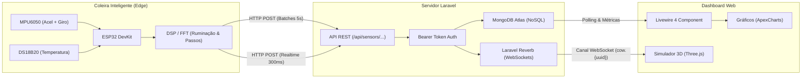

#  🐄 - Sistema de Monitoramento Bovino Inteligente

Uma solução de IoT e telemetria inteligente voltada para a pecuária de precisão. O sistema realiza o monitoramento contínuo da saúde, movimentação, ruminação e postura corporal de bovinos em tempo real utilizando um sensor MPU6050 com ESP32, processamento digital de sinais (DSP/FFT) no próprio dispositivo (Edge Computing), backend em **Laravel** com banco de dados NoSQL **MongoDB Atlas**, WebSockets com **Laravel Reverb** e um dashboard interativo com simulador 3D em **Three.js**.

---

## 📐 Arquitetura do Sistema



---

## 🛠️ Tecnologias Utilizadas

### Hardware e Firmware (Coleira IoT)
- **Microcontrolador**: ESP32 Dual-Core 240MHz com Wi-Fi.
- **Sensor Inercial (IMU)**: MPU6050 (Acelerômetro triaxial $\pm 4g$ e Giroscópio $\pm 500^\circ/s$).
- **Sensor de Temperatura**: DS18B20 (barramento OneWire com resolução de até 12-bits).
- **Processamento de Sinal**: Biblioteca `arduinoFFT` (Transformada Rápida de Fourier em tempo real).
- **Serialização**: `ArduinoJson` (v7).

### Backend
- **Framework**: Laravel 13 (PHP 8.5).
- **Banco de Dados**: MongoDB Atlas (driver oficial `mongodb/laravel-mongodb`).
- **WebSockets / Tempo Real**: Laravel Reverb.
- **Estilo & Componentes**: TailwindCSS & Livewire 4.

### Frontend
- **Renderização 3D**: Three.js (r160) com loader GLTF e suporte a bones (`Bone_Neck`).
- **Gráficos**: ApexCharts para séries temporais de temperatura e atividade.
- **Comunicação em Tempo Real**: Laravel Echo + Pusher-JS.

---

## 📡 Funcionamento do Firmware (ESP32)

O código embarcado encontra-se em [`coleirasensormpu6050/coleirasensormpu6050.ino`](coleirasensormpu6050/coleirasensormpu6050.ino).

### 1. Aquisição de Dados (20 Hz)
- A cada **50 ms** (`INTERVALO_AMOSTRA_MS = 50`), o ESP32 coleta:
  - Acelerações nos eixos $X, Y, Z$ ($m/s^2$);
  - Velocidade angular nos eixos $X, Y, Z$ ($rad/s$);
  - Inclinação calculada:
    $$\text{Pitch} = \text{atan2}(a_x, \sqrt{a_y^2 + a_z^2}) \times \frac{180}{\pi}$$
    $$\text{Roll} = \text{atan2}(a_y, \sqrt{a_x^2 + a_z^2}) \times \frac{180}{\pi}$$

### 2. Detecção de Passos e Locomoção (Hodometria)
- Calcula a magnitude total da aceleração vetorial:
  $$|a| = \sqrt{a_x^2 + a_y^2 + a_z^2}$$
- Quando $|a| > 12.5\ m/s^2$, incrementa o contador `totalPassos` e marca `emMovimento = true`.
- Histerese em $|a| < 10.5\ m/s^2$ para estabilização.

### 3. Detecção de Ruminação via FFT (Edge Computing)
- A ruminação bovina possui um padrão rítmico de mastigação com frequência bem definida entre **0.9 Hz e 1.5 Hz**.
- O firmware alimenta um buffer de 64 amostras (`FFT_SAMPLES = 64`) da velocidade angular do eixo $Z$ (`gz`).
- Aplica a janela de **Hamming** e computa a FFT:
  - Analisa a energia espectral dos bins 3 a 5 (correspondentes à faixa de mastigação a 20 Hz).
  - Quando a magnitude supera o limiar (`maxMagnitude > 3.5`), contabiliza um evento de ruminação (`eventosRuminacao++`) e define `is_ruminating = true`.

### 4. Transmissão Dual-Stream (HTTP REST)
O ESP32 envia dados em dois fluxos complementares:
1. **Canal Realtime (`/api/sensors/realtime` a cada 300ms)**:
   - Envio ultrarrápido contendo `pitch`, `roll`, `is_moving` e `is_ruminating`.
   - Alimenta diretamente o modelo 3D no navegador via WebSockets sem sobrecarregar o banco de dados.
2. **Canal em Lote (`/api/sensors/data` a cada 5 segundos)**:
   - Envio agregado de 50 amostras compactadas, temperatura corporal do animal, total de passos e eventos de ruminação na janela de 5 segundos.
   - Salvo persistentemente no MongoDB Atlas para histórico e geração de relatórios.

---

## 🗄️ Estrutura do Banco de Dados (MongoDB)

Os documentos são armazenados na coleção `sensor_data` no MongoDB Atlas:

```json
{
  "_id": { "$oid": "6acf8014dc6aba8ba00245c9" },
  "device_uuid": "fbd9bb9c-e526-4f9b-a1d7-3dfe21400990",
  "timestamp_unix": 1728912836,
  "sample_count": 100,
  "window_seconds": 5,
  "steps": 14,
  "rumination_events": 3,
  "temperatura_animal": 38.5,
  "samples": [
    [-6.98, 6.36, -0.77, -0.06, 0.0, -0.02, -47.4, 42.2],
    [-6.97, 6.37, -0.71, -0.06, 0.0, -0.01, -47.3, 42.3]
  ],
  "created_at": { "$date": "2026-10-14T13:13:56.808Z" },
  "updated_at": { "$date": "2026-10-14T13:13:56.808Z" }
}
```

Cada elemento do array `samples` contém: `[ax, ay, az, gx, gy, gz, pitch, roll]`.

---

## 🖥️ Recursos do Dashboard Web

1. **Cards Informativos em Tempo Real**:
   - Temperatura Corporal atualizada (°C).
   - Contador de Passos acumulado na janela.
   - Eventos de Ruminação detectados.
   - Ângulo de Inclinação da Cabeça/Pescoço (Pitch).
   - Badge de Status de Comportamento (**💤 Parada**, **🚶 Caminhando**, **🐂 Ruminando**).

2. **Simulador 3D Interativo (Three.js)**:
   - Renderização realista do modelo bovino (`.glb`) com iluminação e sombras.
   - Rotação dinâmica do osso `Bone_Neck` correspondendo exatamente ao pitch e roll do animal no campo.
   - Transição suave entre animações esqueléticas (`Idle`, `Walk`, `Chew`) via máquina de estados baseada nas detecções do sensor.
   - Modo tela cheia e controles de órbita via mouse.

3. **Gráficos Históricos (ApexCharts)**:
   - Gráfico de linha da evolução da temperatura ao longo do tempo.
   - Gráfico de barras empilhadas mostrando a relação entre locomoção (passos) e ruminação em cada janela temporal.

---

## 🔒 Segurança

- Autenticação via **Bearer Token** em todas as requisições enviadas pelo ESP32 (`Authorization: Bearer <TOKEN>`).
- UUID individual para cada coleira / animal monitorado.
- Canais de transmissão WebSocket isolados por animal (`cow.{device_uuid}`).

---

## 🚀 Como Iniciar?

Consulte o arquivo [**README OR DIE.md**](README%20OR%20DIE.md) para o passo a passo completo de instalação do ambiente, configuração das portas, dependências e execução do projeto.
